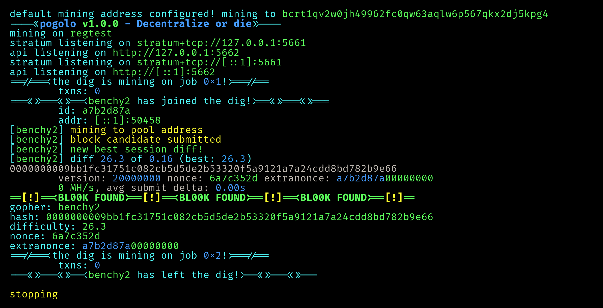

```
/pogolo - decentralize or die/
```

solo db-less bitcoin-only mining pool, meant for lan swarms, not the internet;  
start it, point your miners to it, and watch the logs roll by  

infinite thanks to btcd for bitcoin tooling and public-pool for reference  
[](https://apps.umbrel.com/app/pogolo)

_want a go pool you can run on the public internet? check out https://github.com/Distortions81/M45-Core-goPool!_

- [features](#features)
- [install](#install)
    - [umbrel](#umbrel)
    - [docker](#docker)
    - [go](#go)
    - [manual install](#manual-install)
    - [webui](#webui)



# features

- set a default address to mine to, no more ctrl+c ctrl+v ctrl+v ctrl+v ctrl+v ctrl+v
- SV1 and SV2 on the same port
- colorful and detailed logs (respects NO_COLOR)
- read-only api
- zmq and btcd websocket support
- high performance and low memory usage (119k shares/sec @ ~50 mib + 6kib/client)

## implemented BIPs

- 34
- 41 (probably)
- 54 (coinbase, relies on a compliant backend for the rest)
- 310 (minus `subscribe-extranonce`)
- 323

## supported miners

- \*axe family (bitaxe, nerd\*axe, etc)
- cpuminer
- antminers
- braiins OS

## supported backends

pogolo has no tls support.

- JSON-RPC (no longpoll)
- btcd websocket
- ZMQ (`hashblock` topic)

## unsupported

- whatsminers (they dont mine on the provided jobs, if you have one please test and send logs)
- luckyminers/other non-foss axe clones (intentionally)
- sv2: multiple channels on one conn
- sv2: group channels

## api

the api is documented in [`openapi.yaml`](./openapi.yaml), and exposed at `/openapi.yaml`.

# install

## umbrel

get pogolo from the umbrel app store: https://apps.umbrel.com/app/pogolo  
it comes with a pretty webui based off of the umbrel bitcoin app :3  
then point your miners to stratum+tcp://umbrel.local:5661 or stratum2+tcp://umbrel.local:5661

## docker

image at https://hub.docker.com/r/0xf0xx0/pogolo

copy the pogolo.toml from [`contrib/pkgs/docker`](./contrib/pkgs/docker), configure it to your needs, then run

```sh
docker run -d -v "./pogolo.toml:/config/pogolo.toml" 0xf0xx0/pogolo:latest
```

docker compose exists but likely needs tweaks, its also under [`contrib/pkgs/docker`](./contrib/pkgs/docker)

### environment overrides

for easy config

```yaml
POGOLO_HOST: # overrides [pogolo].host
POGOLO_BACKEND_HOST: # overrides [backend].host
POGOLO_BACKEND_RPCAUTH: # overrides [backend].rpcauth
POGOLO_BACKEND_ZMQHOST: # overrides [backend].zmq_host
```

## go

```sh
go install git.0xf0xx0.eth.limo/0xf0xx0/pogolo@latest
```

then follow [manual install/configure](#configure).

## manual install

### build

```sh
git clone https://git.0xf0xx0.eth.limo/0xf0xx0/pogolo.git
cd pogolo
go build -trimpath -ldflags="-s -w -buildid="
go install
```

### configure

```sh
# create config dir
mkdir "$XDG_CONFIG_HOME/pogolo"

# write embedded default config (preferred)
pogolo --writedefaultconf "$XDG_CONFIG_HOME/pogolo/pogolo.toml"
# OR copy the example config
cp contrib/pogolo.example.toml "$XDG_CONFIG_HOME/pogolo/pogolo.toml"

# configure interface, backend, and auth
vim "$XDG_CONFIG_HOME/pogolo/pogolo.toml"
```

### run

```sh
pogolo
```
theres a systemd unit at [`contrib/init/pogolo.service`](./contrib/init/pogolo.service) 
for bare installs  
it expects pogolo to be in the system PATH, a `bitcoin` group, and a config file at `/etc/pogolo/pogolo.toml`.
```sh
sudo cp contrib/init/pogolo.service /etc/systemd/system/
sudo mkdir -p /etc/pogolo
pogolo --writedefaultconf /etc/pogolo/pogolo.toml
sudo chmod -R 755 /etc/pogolo
sudo chown -R :bitcoin /etc/pogolo 
sudo systemctl enable --now pogolo
```

## webui

the webui is containerized at https://hub.docker.com/r/0xf0xx0/pogolo-umbrel-webui  
its intended for umbrel but perfectly usable outside, as long as you setup the environment.  
see: https://github.com/0xf0xx0/pogolo-umbrel-webui

# miner config

host: stratum+tcp://\<your lan ip\>:5661 OR stratum2+tcp://\<your lan ip\>:5661  
username: [your onchain address][.\<worker name\>]  
password: [required if set in pogolo.toml]  
suggested diff: [optional]

the worker name is optional.
the onchain address is also optional if the pool has a default address configured.

# benchmarking

to reproduce shares/s result:  
benchmark with https://github.com/Erikslund-net/open-pool-benchmark

# TODO
- link stratum and mining docs  
   waiting for bip 41  
   https://web.archive.org/web/20201130051808/https://braiins.com/stratum-v1/docs
- prometheus metrics (half-done)
    - block submission metrics
- aur packages (under [contrib/pkgs/arch](./contrib/pkgs/arch), needs a maintainer)

# blocks found

## mainnet
none yet :3

## testnet5
6206 `0000000000000008e3d0b345c6d3ff5b3d1b1273d57bd939ec8b639728417ff7`  
6210 `0000000000000031f2f4809d629fee36e24230cf005527490dadfdba8f626fdd`  
6213 `0000000000000037baa2a24cc38ab22390260639b117fce114d4fcd7cf5ac8fb`  
6218 `000000000000003bd1be6a4833eba98cd7a139f71546648dfbc7fa499e0741f7`  
6227 `000000000000001524895816207028c09793d543bc1df5781778804075c550c1`  
6233 `0000000000000006b2e0a06c55df11584078553704cb2da67782472a2443231d`  
6255 `00000000000000154f9b0ea3e480bd50edb6f48b82c7c80ae2c62910ec0e951e`  
6311 `0000000000000014dba90d0d6b0e21649c7f5aeb037f1fb3a10b0f8e689a7a42`  
6390 `000000000000000a07afa3ae1662ab64303ab782eeaf7e7df40731c7f9e66fb6`  
6465 `000000000000000eed5fdcecca670151fe1d65203a81130a10dd422e27d0a433`  
6538 `0000000000000038d0a0781e56883c5839e250f8a3a81f6330b38cba5deb398c`  
6554 `000000000000001cb2e0dc0f2d0914367ba93167ff41b51e64cb261162212ed2`  
6572 `00000000000000325c81dc789b84b62dc06e083c8a805c0dadeba8049e853a6f`  
6589 `0000000000000039232cc6b9ce14c85b951c3fbb47c7ef5d67744aba69eb00ad`  

## testnet4
151973 `000000000000000079a9aeebf8ab51a6448b0db1a556eca26cbedf1d6f55b67b`  
151981 `000000000000000175e11bb8c8acac417d290746a798bff7c3f53c36aa9cef3c`
